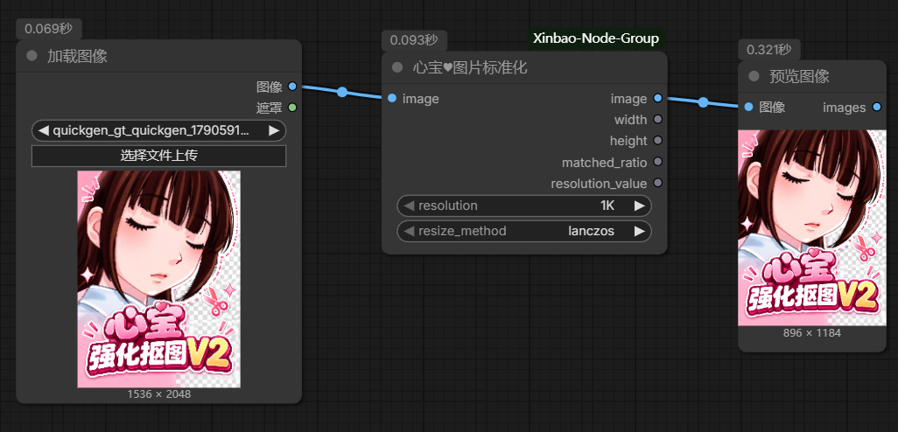
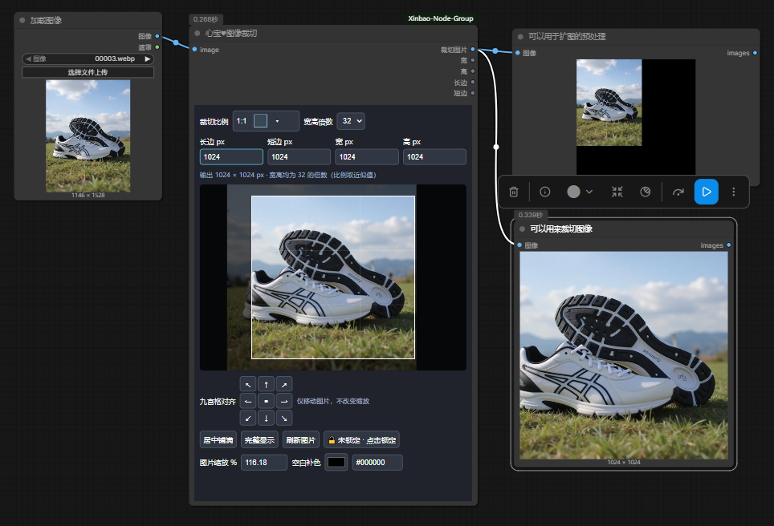
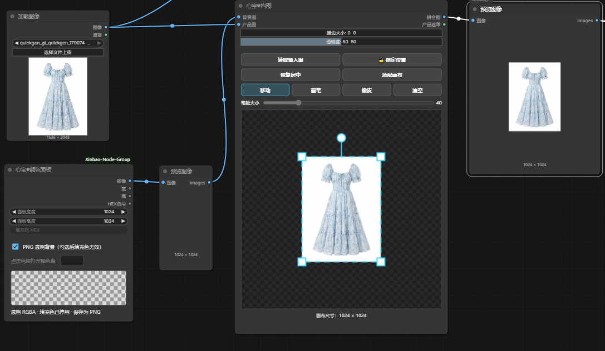
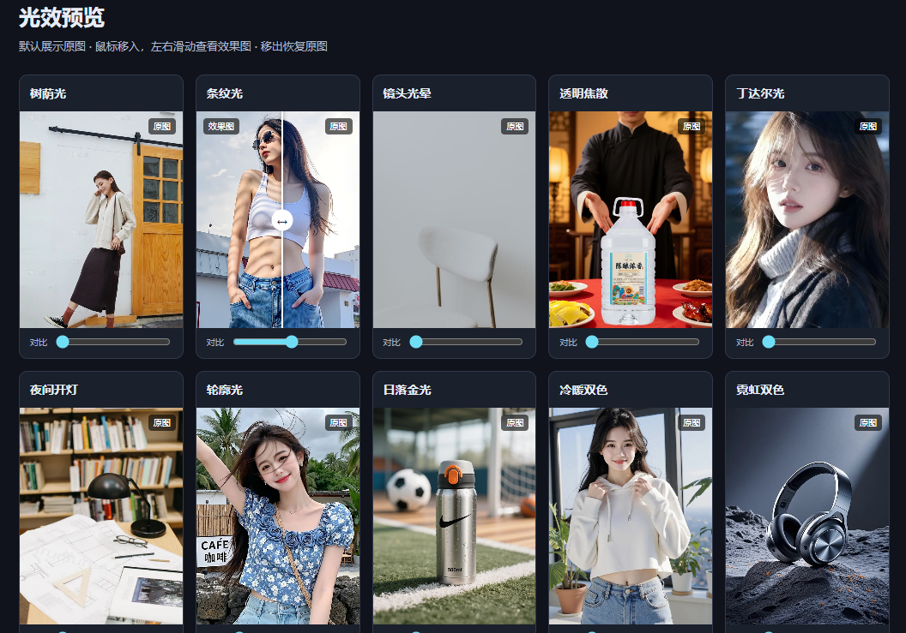

# ComfyUI Xinbao Node Group

`ComfyUI-Xinbao-Node-Group` 是心宝自用并长期维护的实用 ComfyUI 节点集合。以后新增的通用自定义节点会继续放进这个仓库，ComfyUI 中的分类统一为 `心宝♥节点组`。

## 当前包含的功能

### 心宝♥图片标准化



为了满足 Qwen-Image 2.1 及众多图像模型的标准尺寸要求，对输入图进行自动标准化处理，减少尺寸和比例不规范造成的画面、构图偏移问题。

### 心宝♥图像裁切



选择 13 种预设比例，或选择「自定义」输入宽 : 高（支持小数，例如 2.35 : 1）。输入长边、短边、宽或高后，其余三项自动计算；默认长边 1024，不使用 1K/2K 档位。宽高按 8、16、32 倍数对齐，取整后比例会有少量误差。

拖动、缩放图片调整居中裁切框内的画面，空白处可选择补色，默认黑色。点击锁定可固定比例、尺寸、位置、缩放和补色，随工作流保存。连接「加载图像」直接预览；其他上游处理节点需先运行一次获取输入预览，再调整并运行。批量图片共用设置，预览第一张。输出裁切图片、宽、高、长边、短边，无需模型。

比例列表按宽高比从小到大排列：竖图 → 正方形 → 横图，每项带形状图标，自定义放最后。九宫格可一键将图片对齐至裁切框的九个位置，只移动图片、不改变缩放；缩小或放大后的图片均可使用，锁定后不可修改。

### 心宝♥颜色面板



设置宽高（默认 512 × 512），输入 HEX 色号或点击色块打开颜色盘，输出纯色图片、宽、高和规范化色号，默认黑色，无需模型。

勾选「PNG 透明背景」后填充色失效，输出全透明 RGBA 图像，连接 ComfyUI「保存图像」即可保存透明 PNG；取消勾选恢复原颜色。透明模式的色号输出为 `#00000000`，其他下游处理节点需支持透明通道。

[裁切与颜色面板演示工作流](examples/xinbao_crop_and_color.json)：不含输入或输出图片，上传自己的图片即可使用。

### 心宝♥构图

- 在节点画布内交互式移动、缩放和旋转产品图；
- 产品图为可选输入，仅连接背景图时直接输出背景和全黑遮罩；
- 上游图片节点禁用或绕过后，编辑器不再读取其图片，并清除对应预览；
- 支持外描边、透明度、画笔和橡皮；
- 最终画布尺寸跟随背景图；
- 同时输出合成图片与产品遮罩。

### 心宝♥LoRA加载

在一个节点中批量加载并叠加多个 LoRA，节省工作流空间。列表显示已安装的 LoRA；每个 LoRA 都能单独调整强度，滑条控制，随心设置。

- 所有加载项使用统一样式：上方选择模型，下方滑条和数值框调节强度；点击「增加／减少」管理加载项。每项均可按模型名称或文件夹关键词搜索，已有首项输入连线继续保留。
- 强度范围 `0–2`、默认 `1`、步进 `0.1`；仅输入、输出模型。
- 点击「点击查看更多分享」可访问心宝的哔哩哔哩主页。
- LoRA 加载支持 Windows x64、CPython 3.10–3.14（标准版），自动适配新旧 ComfyUI 加载接口；兼容整合包、便携版和虚拟环境。

### 心宝❤透视调节

选择场景旋转角度（−90°、−45°、0°、45°、90°）、摄像机高度（低、中、高、顶）及距离（中、大），输出包含 `Xinbao` 的完整中文透视提示词。可旋转的女性石膏像、墙面和地面帮助预览视角；提示词可连接 Qwen-Image 2.1 的文本输入。实际转换效果取决于所用图像模型和 LoRA。

#### 2026-11-01 更新

- 新增透视调节节点与本地三维视角预览，按场景旋转方向输出包含摄像机运动、焦点、距离和场景一致性要求的提示词。
- LoRA 加载节点现可选择已安装的普通 LoRA，支持批量叠加；模型选择与强度分行显示，首项可接入其他节点控制。

### 心宝♥外轮廓拼脸

将已经转好姿态、抠出遮罩的脸作为独立图层，按底图脸部外轮廓自动等比缩放和平移，再合成到底图。底图不参与变换；没有覆盖的区域保持输入像素。

- 输入：底图、转姿态后的完整图、与姿态图同尺寸的脸部遮罩。
- 只用两侧脸颊、下颌、下巴的17个外轮廓点；五官、头发和遮罩边界不参与拟合。检测器不提供额头上缘轮廓。
- 额外缩放 `face_scale_percent` 默认 **0%**，范围 **−20%～20%**，以自动对齐后的脸部轮廓中心缩放。支持横向、纵向移动，以及可选的平面倾斜对齐。
- 输出：拼合图、变换后的遮罩、轮廓叠加预览、对齐报告。白色描边继续由工作流已有遮罩/合成节点完成，本节点本身不生成描边。
- 保留现有工作流节点 ID `XinbaoFaceContourCompositeV2`，无需更换已使用V2的连线。不再注册旧的 `XinbaoFaceAlignedComposite` 和白膜校正节点。
- 最大脸部轮廓作为目标。背景多人、小脸、墨镜、严重遮挡可能导致误检；对齐报告为检测估计，不保证所有轮廓点完全重合，不修正三维朝向。

使用 ComfyUI 的 Python 安装本仓库 `requirements.txt`，并将以下两个 ONNX 模型放到 `ComfyUI/models/pose/`：

- `yolox_m_8xb8-300e_humanart-c2c7a14a.onnx`
- `rtmw-x_simcc-cocktail14_pt-ucoco_270e-384x288-f840f204_20231122.onnx`

使用 RTMLib + ONNX Runtime 在 CPU 检测。模型不随仓库发布，也不自动下载；缺失时节点会给出具体文件路径。缺少检测依赖不影响其他节点的导入。

升级时请移走旧的独立 `xinbao_white_face_geometry` 插件，避免重复注册同一节点 ID。此版本同时移除“心宝♥自定标签”，已有个人标签数据请自行保留备份。

### 心宝♥文本联结

连接多段可选文本；上游禁用导致某路文本缺失时，跳过该输入并联结其余内容。

### 心宝♥深度调节

用于视频复刻流程：调节深度视频的阈值、灰度层级和细节强度，让深度控制视频更适合下游视频生成模型，以获得更好的复刻效果。节点对整批视频帧使用同一组参数，不会因后处理参数逐帧变化而破坏连贯性。

- `low_threshold` / `high_threshold`：选择有效深度范围，低阈值必须小于高阈值；
- `gamma`：调节中间深度，`1.0` 为原样；
- `depth_levels`：`256` 最精细，数值越小越粗糙，`2` 为两层剪影；
- `smoothing`：去除细碎深度，数值越大越平滑；
- `invert`：反转远近的黑白方向。

推荐预设：

- 精细：`0.02 / 0.98 / 1.0 / 256 / 0`
- 标准：`0.05 / 0.95 / 1.0 / 64 / 0.5`
- 粗糙：`0.10 / 0.90 / 1.0 / 12 / 2.0`
- 两层剪影：`0.45 / 0.55 / 1.0 / 2 / 1.0`

### 心宝♥打光搭档



无需搭配 LoRA 也可使用的可视化提示词搭档，内置 **18 种光效**，点击即可选用，多选可叠加，再点一次取消，无需手动记忆和拼接完整提示词；也可搭配心宝全能打光 LoRA 使用。

- **6 种常用光效**：树荫光、条纹光、镜头光晕、透明焦散、丁达尔光、夜间开灯。
- **12 种扩展光效**：轮廓光、日落金光、冷暖双色、霓虹双色、戏剧聚光、月光、舞台追光、火光、水波光影、彩色投影、硬光切割、棱晶虹光。
- **光照方向（开发中，有待完善）**：提供九宫格中的 8 个方向（左上、上、右上、左、右、左下、下、右下），以及正前方、正后方，共 **10 个方向＋1 个默认选项**，方向为单选。开启“仍要体验”后才能选择并输出方向词；开关默认关闭，“默认”选项不追加方向词。
- **光线作用主体**：勾选后，对选中的树荫光、条纹光追加主体受光与遮挡投影要求，让光影明确作用于人物或产品表面。
- **补充说明**：支持输入自己的要求，与所选光效一起输出。
- **光效预览**：独立窗口展示 18 组案例，默认显示效果图，鼠标移入并左右移动即可对比原图，也可拖动滑块查看；统一裁切尺寸，方便比较。

节点输出一个文本，可连接到工作流的提示词输入或文本拼接节点。开启方向体验时，输出顺序为 **方向词 → 光效词 → 补充说明**；关闭时仅输出光效词与补充说明。节点负责组合提示词，实际出图效果由所用模型、可选 LoRA 和工作流共同决定。

### 其他功能

- **心宝♥提示词助手**：管理、分类并快速组合常用提示词片段；数据保存在本插件目录。
- **心宝♥合成PSD**：把一批图片写入同一个带图层的 PSD 文件。
- **心宝♥分层数**：把“一层至五层”的选择转换为详情页流程使用的数量。
- **心宝♥智能拼图**：自动将 1～4 张图片纵向或 2×2 拼合。
- **心宝♥图片加载**：带清空占位图的本地图片加载节点。
- **心宝♥图片拆分**：将图片拆成四方格或九宫格批次。
- **心宝♥图像分割**：使用 SAM + GroundingDINO 按提示词进行本地抠图。
- **心宝♥小红书选项**：按街拍裂变或首饰佩戴用途，生成提示词、画面比例及对应模型标识。

## 安装节点

把仓库克隆到 ComfyUI 的 `custom_nodes` 目录：

```powershell
cd ComfyUI\custom_nodes
git clone https://github.com/lishuihan123/ComfyUI-Xinbao-Node-Group.git
```

LoRA 加载所需运行组件已随包提供；其他功能仍需安装下方依赖。完成后重启 ComfyUI 并刷新浏览器，即可在 `心宝♥节点组` 分类中找到以上功能：

```powershell
pip install -r requirements.txt
```

Pillow、NumPy、PyTorch 和 torchvision 由常规 ComfyUI 环境提供；合成 PSD 额外使用 `psd-tools`，Python 3.10 的提示词助手额外使用 `toml`，图像分割所需依赖由 `requirements.txt` 一并声明。

`心宝♥推理（极速版）` 已拆分为独立项目：[`ComfyUI-Xinbao-Inference-Fast`](https://github.com/lishuihan123/ComfyUI-Xinbao-Inference-Fast)。需要提示词扩写、图片/视频反推时请单独安装该仓库。

## 更新计划

这是长期维护的通用节点组。后续心宝自用的实用功能会继续加入本仓库。大型推理功能不再放入本仓库，欢迎通过 Issues 反馈问题。
